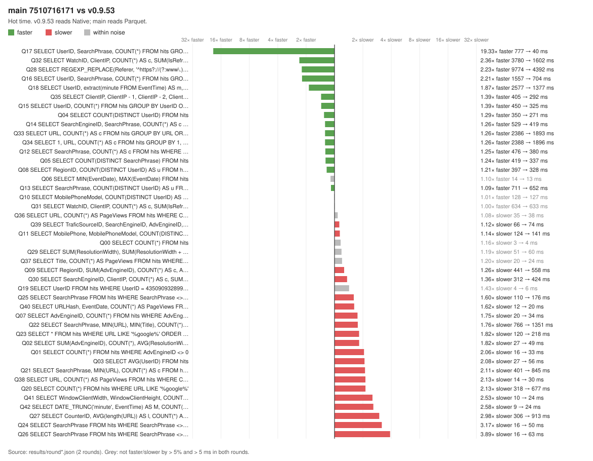
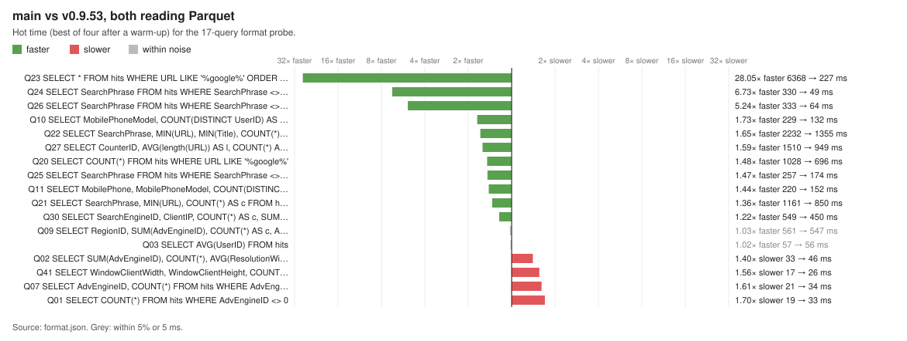
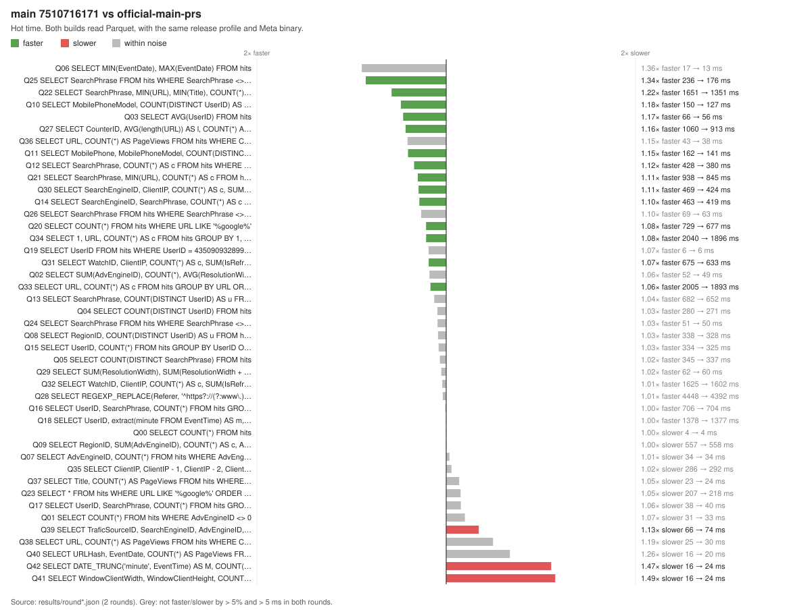
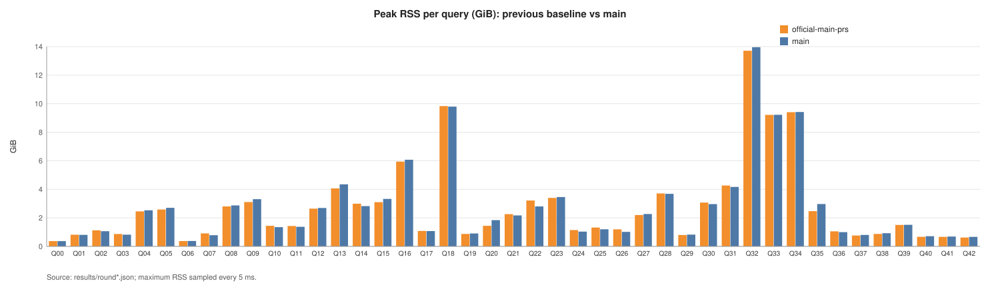
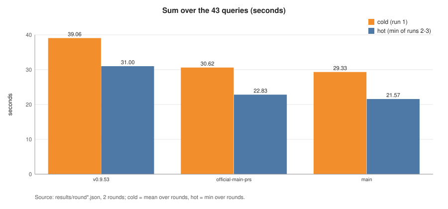

# PR #21163 — ClickBench retest on main

## Summary

Follow-up to the [original PR Summary](../PR-21163-ORIGINAL-SUMMARY.md). `main` is upstream commit [`7510716171`](https://github.com/databendlabs/databend/commit/7510716171d90a81ea3df8806ac4cc291a1473e5); `official-main-prs` is a fresh build of `581c894436` (the previous `177b395dd3` + #21138 + #21144 baseline). `v0.9.53` is the original ClickBench release. All three rows below were measured again, interleaved on the same host.

Method: the original `create.sql`, `queries.sql` and two-step load from the same SHA-256-verified `hits.parquet` (99,997,497 rows). Query and Meta are pinned to CPUs 0–15. Each cell restarts both processes after `posix_fadvise(DONTNEED)`; run 1 is cold, the faster of runs 2–3 is hot. Two rounds with reverse release order; the summary takes the mean cold, best hot and maximum sampled RSS for each query, then sums over Q00–Q42. Both 1.x builds use the same release build settings and v1.2.967 Meta.

| release | cold sum | hot sum | Q32 peak RSS | hot geomean vs v0.9.53 |
|---|---:|---:|---:|---:|
| v0.9.53 | 39.06 s | 31.00 s | 13.9 GiB | 1.000 |
| official-main-prs | 30.62 s | 22.83 s | 13.7 GiB | 1.173 |
| main | 29.33 s | 21.57 s | 14.0 GiB | 1.142 |

Findings:

- **main vs official-main-prs.** Cold sum -4.2%, hot sum -5.5%, peak RSS geomean +0.3%. 14 consistently faster, 3 consistently slower. Both rounds must move in the same direction by more than 5% and 5 ms.
- **main vs v0.9.53.** Cold sum -24.9%, hot sum -30.4%, peak RSS geomean +0.9%. 15 consistently faster, 20 consistently slower. Both rounds must move in the same direction by more than 5% and 5 ms.
- **Storage format and layout.** The v0.9.53 comparison mixes Native and Parquet. Tables were loaded separately, so block layout can differ even within Parquet.

| release | rows | blocks | table data bytes |
|---|---:|---:|---:|
| v0.9.53 | 99997497 | 778 | 20753080135 |
| official-main-prs | 99997497 | 732 | 14785881065 |
| main | 99997497 | 782 | 13696309790 |

## Trace

To separate execution from layout, both binaries read copies of the **same 732-block Parquet snapshot** written by `official-main-prs`. The 14-case probe used two interleaved rounds (reverse order in the second), with one warm-up and four timed hot runs per cell. Deltas below are the two round deltas, not confidence intervals.

| Case | Fresh tables: hot delta | Same snapshot: hot delta | Likely explanation |
|---|---:|---:|---|
| Q25, string TopN | −25.5%, −26.1% | −23.3%, −25.2% | The plan sorts `SearchPhrase` and pushes `LIMIT 10` into the scan. [#21210](https://github.com/databendlabs/databend/pull/21210) changed string comparisons and heap updates in TopK; [#21159](https://github.com/databendlabs/databend/pull/21159)'s empty-string selector is another candidate. Same-snapshot scan CPU fell from 3.56 s to 2.71 s. The two changes were not isolated. |
| Q10 / Q30, `<> ''` | Q10 −15.3%, −15.9%; Q30 −9.7%, −8.8% | Q10 −19.1%, −20.1%; Q30 −9.4%, −8.3% | [#21159](https://github.com/databendlabs/databend/pull/21159) added a length-only fast path to the scan selector for `<> ''`; the old fast path in the scalar evaluator did not cover this selector. [#21208](https://github.com/databendlabs/databend/pull/21208)'s generic view comparator runs after that fast path, so it is not the first suspect. Q11/Q12/Q14/Q31 share the predicate shape but were not run on the shared snapshot. |
| Q03, `AVG(UserID)` | −11.3%, −14.6% | −15.5%, −16.2% | Both scan 732 blocks and 199.96 MiB; scan CPU drops from 0.99 s to 0.88 s. [#21183](https://github.com/databendlabs/databend/pull/21183) removes per-block Parquet schema setup and is a plausible contributor; [#21180](https://github.com/databendlabs/databend/pull/21180) also changes block decoding and was not isolated. |
| Q20/Q21/Q22/Q27 and Q33/Q34, URL-heavy scans | Q22 −18.4%, −17.7%; Q27 −12.8%, −13.8% | Neither improves on the shared snapshot; Q22 +2.4%, +3.4%, Q27 +2.5%, −1.2%. The other cases also lose their stable speedups. | The improvement is layout-sensitive. On separately loaded tables, Q22 reads 4.58 → 3.71 GiB and the URL-only scans read 2.24 → 1.90 GiB. A likely contributor is [#21159](https://github.com/databendlabs/databend/pull/21159)'s default **writer** change (dictionary NDV threshold 0.1 → 0.5, dictionary-page limit 1 → 16 MiB). [#21171](https://github.com/databendlabs/databend/pull/21171)'s staged `PREWHERE` can affect Q21/Q22, but the snapshot control does not support assigning their headline gains to it. |
| Q39 / Q41, selective queries | +8.3 / +7.9 ms in best-hot summaries | Both within 1 ms of the control in both rounds | Both versions prune to eight blocks and read the same bytes from the shared snapshot. These regressions did not reproduce with the layout fixed; no specific PR is isolated. |
| Q42, minute bucket with `LIMIT 10 OFFSET 1000` | 16.0 → 23.5 ms | 14.5 → 19.7 ms; 15.0 → 19.9 ms | The clearest execution regression. Both scan eight blocks and 6.13 MiB. Only `main` adds `rank limit: 1010` to `AggregatePartial` (4.16 → 29.99 ms operator CPU in the sampled profile). [#20780](https://github.com/databendlabs/databend/pull/20780) is the likely trigger: the grouped sort expression now binds to the actual group key, making the existing rank-limit rule applicable. Rewriting only the sort key to `ORDER BY to_int64(M)` preserves all result rows and bypasses rank-limit on `main`: median 20.15 → 14.39 ms over 20 interleaved pairs. This isolates the plan shape, not the PR via a revert. |

[#21138](https://github.com/databendlabs/databend/pull/21138) and [#21144](https://github.com/databendlabs/databend/pull/21144) were already in `581c894436`; the final aggregate implementation is unchanged between these builds. `enable_encoded_columns` and `enable_condition_cache` are both 0 on `main`, so neither the encoded-column read path in #21159 nor cache hits from [#21182](https://github.com/databendlabs/databend/pull/21182) explain these default runs.

Evidence: [independently loaded plans](trace.json), [same-snapshot timings](same-layout.json), [same-snapshot profiles](same-layout-trace.json), [Q42 rank-limit probe](q42-rank-limit.json).

## Same-format probe (v0.9.53 Parquet vs main Parquet)

Separate hot-only probe: best of four runs after one warm-up. Of 17 cases, 11 are faster and four slower by more than 5% and 5 ms; two fall inside that cutoff. Q01, Q02 and Q07 still lose 13–14 ms, and Q41 loses 9 ms. Do not pool these timings with the interleaved rounds.

| case | v0.9.53 Native | v0.9.53 Parquet | main Parquet | main / v0.9.53 Parquet |
|---|---:|---:|---:|---:|
| Q01 | 0.0215 s | 0.0194 s | 0.0330 s | 1.70 |
| Q02 | 0.0273 s | 0.0330 s | 0.0463 s | 1.40 |
| Q03 | 0.0276 s | 0.0566 s | 0.0556 s | 0.98 |
| Q07 | 0.0177 s | 0.0209 s | 0.0337 s | 1.61 |
| Q09 | 0.4849 s | 0.5614 s | 0.5466 s | 0.97 |
| Q10 | 0.1491 s | 0.2292 s | 0.1323 s | 0.58 |
| Q11 | 0.1427 s | 0.2195 s | 0.1523 s | 0.69 |
| Q20 | 0.3873 s | 1.0283 s | 0.6955 s | 0.68 |
| Q21 | 0.4677 s | 1.1609 s | 0.8505 s | 0.73 |
| Q22 | 0.9155 s | 2.2323 s | 1.3546 s | 0.61 |
| Q23 | 0.1346 s | 6.3682 s | 0.2270 s | 0.04 |
| Q24 | 0.0191 s | 0.3298 s | 0.0490 s | 0.15 |
| Q25 | 0.1407 s | 0.2567 s | 0.1745 s | 0.68 |
| Q26 | 0.0167 s | 0.3329 s | 0.0635 s | 0.19 |
| Q27 | 0.3907 s | 1.5100 s | 0.9493 s | 0.63 |
| Q30 | 0.3469 s | 0.5489 s | 0.4500 s | 0.82 |
| Q41 | 0.0110 s | 0.0169 s | 0.0263 s | 1.56 |

Raw probe and scan plans: [format.json](format.json).

## Encoded columns only

A separate [same-snapshot comparison](encoded-columns/README.md) changes only `enable_encoded_columns` on `main`. With all other settings unchanged, cold and hot totals fall by 13.1% and 15.8%, respectively. That comparison has its own default arm; do not pool its timings with the version comparison above.

## Charts

## Per query (cold / hot, seconds)

| case | v0.9.53 | official-main-prs | main | main / previous hot | main / v0.9.53 hot |
|---|---:|---:|---:|---:|---:|
| Q00 | 0.012 / 0.003 | 0.028 / 0.004 | 0.027 / 0.004 | 1.00 | 1.16 |
| Q01 | 0.146 / 0.016 | 0.147 / 0.031 | 0.153 / 0.033 | 1.07 | 2.06 ↑ |
| Q02 | 0.176 / 0.027 | 0.204 / 0.052 | 0.198 / 0.049 | 0.94 | 1.82 ↑ |
| Q03 | 0.188 / 0.027 | 0.192 / 0.066 | 0.219 / 0.056 | 0.85 ↓ | 2.08 ↑ |
| Q04 | 0.498 / 0.350 | 0.438 / 0.280 | 0.443 / 0.271 | 0.97 | 0.77 ↓ |
| Q05 | 0.586 / 0.419 | 0.514 / 0.345 | 0.518 / 0.337 | 0.98 | 0.80 ↓ |
| Q06 | 0.144 / 0.014 | 0.045 / 0.017 | 0.055 / 0.013 | 0.73 | 0.91 |
| Q07 | 0.147 / 0.019 | 0.190 / 0.034 | 0.178 / 0.034 | 1.01 | 1.75 ↑ |
| Q08 | 0.553 / 0.397 | 0.518 / 0.338 | 0.516 / 0.328 | 0.97 | 0.83 ↓ |
| Q09 | 0.617 / 0.441 | 0.748 / 0.557 | 0.770 / 0.557 | 1.00 | 1.26 ↑ |
| Q10 | 0.296 / 0.129 | 0.329 / 0.150 | 0.296 / 0.127 | 0.85 ↓ | 0.99 |
| Q11 | 0.298 / 0.124 | 0.336 / 0.162 | 0.304 / 0.141 | 0.87 ↓ | 1.14 ↑ |
| Q12 | 0.647 / 0.476 | 0.618 / 0.427 | 0.588 / 0.380 | 0.89 ↓ | 0.80 ↓ |
| Q13 | 0.929 / 0.711 | 0.930 / 0.682 | 0.902 / 0.652 | 0.96 | 0.92 ↓ |
| Q14 | 0.705 / 0.529 | 0.677 / 0.463 | 0.617 / 0.419 | 0.91 ↓ | 0.79 ↓ |
| Q15 | 0.626 / 0.450 | 0.498 / 0.334 | 0.511 / 0.325 | 0.97 | 0.72 ↓ |
| Q16 | 1.801 / 1.557 | 0.947 / 0.707 | 0.965 / 0.704 | 1.00 | 0.45 ↓ |
| Q17 | 1.019 / 0.777 | 0.195 / 0.038 | 0.173 / 0.040 | 1.06 | 0.05 ↓ |
| Q18 | 2.864 / 2.577 | 1.659 / 1.379 | 1.685 / 1.377 | 1.00 | 0.53 ↓ |
| Q19 | 0.169 / 0.004 | 0.179 / 0.006 | 0.205 / 0.006 | 0.94 | 1.43 |
| Q20 | 0.621 / 0.318 | 0.980 / 0.729 | 0.944 / 0.677 | 0.93 ↓ | 2.13 ↑ |
| Q21 | 0.730 / 0.401 | 1.261 / 0.938 | 1.141 / 0.845 | 0.90 ↓ | 2.11 ↑ |
| Q22 | 1.238 / 0.766 | 2.124 / 1.651 | 1.746 / 1.351 | 0.82 ↓ | 1.76 ↑ |
| Q23 | 0.502 / 0.119 | 0.410 / 0.207 | 0.402 / 0.218 | 1.05 | 1.82 ↑ |
| Q24 | 0.150 / 0.016 | 0.202 / 0.051 | 0.200 / 0.050 | 0.97 | 3.17 ↑ |
| Q25 | 0.260 / 0.110 | 0.393 / 0.236 | 0.328 / 0.176 | 0.74 ↓ | 1.60 ↑ |
| Q26 | 0.154 / 0.016 | 0.207 / 0.069 | 0.218 / 0.063 | 0.91 | 3.89 ↑ |
| Q27 | 0.638 / 0.306 | 1.363 / 1.060 | 1.197 / 0.913 | 0.86 ↓ | 2.98 ↑ |
| Q28 | 9.374 / 9.774 | 4.006 / 4.448 | 3.965 / 4.392 | 0.99 | 0.45 ↓ |
| Q29 | 0.210 / 0.051 | 0.261 / 0.062 | 0.257 / 0.060 | 0.98 | 1.19 |
| Q30 | 0.540 / 0.312 | 0.689 / 0.469 | 0.658 / 0.424 | 0.90 ↓ | 1.36 ↑ |
| Q31 | 0.904 / 0.634 | 1.004 / 0.675 | 0.944 / 0.633 | 0.94 ↓ | 1.00 |
| Q32 | 4.167 / 3.780 | 1.916 / 1.625 | 1.896 / 1.602 | 0.99 | 0.42 ↓ |
| Q33 | 2.701 / 2.385 | 2.365 / 2.005 | 2.219 / 1.893 | 0.94 ↓ | 0.79 ↓ |
| Q34 | 2.712 / 2.388 | 2.363 / 2.040 | 2.217 / 1.896 | 0.93 ↓ | 0.79 ↓ |
| Q35 | 0.570 / 0.405 | 0.473 / 0.286 | 0.442 / 0.292 | 1.02 | 0.72 ↓ |
| Q36 | 0.177 / 0.035 | 0.190 / 0.043 | 0.187 / 0.037 | 0.87 | 1.08 |
| Q37 | 0.161 / 0.020 | 0.161 / 0.023 | 0.167 / 0.024 | 1.05 | 1.20 |
| Q38 | 0.154 / 0.014 | 0.159 / 0.025 | 0.163 / 0.030 | 1.19 | 2.13 ↑ |
| Q39 | 0.213 / 0.066 | 0.232 / 0.066 | 0.222 / 0.074 | 1.13 ↑ | 1.12 ↑ |
| Q40 | 0.162 / 0.013 | 0.154 / 0.016 | 0.189 / 0.020 | 1.26 | 1.62 ↑ |
| Q41 | 0.144 / 0.009 | 0.164 / 0.016 | 0.167 / 0.024 | 1.49 ↑ | 2.53 ↑ |
| Q42 | 0.159 / 0.009 | 0.150 / 0.016 | 0.141 / 0.024 | 1.47 ↑ | 2.58 ↑ |

## Result consistency

Differences below are descriptive. Unordered `LIMIT`, ties, numeric formatting, and the historical `length` semantic change can alter hashes. A different hash does not establish a correctness bug.

- **main vs official-main-prs:** row-count sets differ for none; hash sets differ for Q24, Q31, Q32, Q38, Q39, Q40, Q41.
- **main vs v0.9.53:** row-count sets differ for none; hash sets differ for Q03, Q17, Q24, Q27, Q28, Q31, Q32, Q38, Q39, Q40, Q41.

For Q31/Q32 the sampled groups at the limit boundary all have `COUNT(*) = 1`; Q38/Q39/Q40/Q41 also have ties in the reported sort key. No secondary sort key was added to the timed SQL.

Inputs and reproducibility: [manifest](manifest.json), [loads](loads/), [raw rounds](results/), [original SQL and harness](../README.md). The rerun used a scratch copy of `bench.py` with isolated paths and the three labels above; the archived scripts and timings were not overwritten. Non-empty credential fields in the load configurations are redacted.
