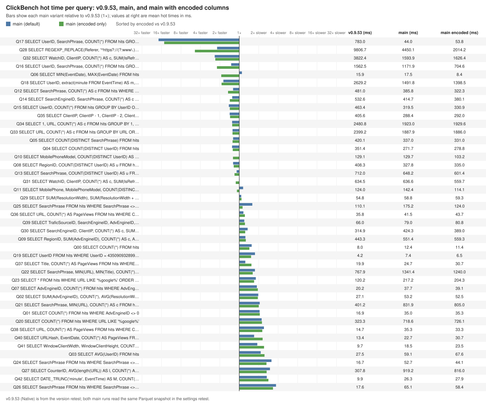
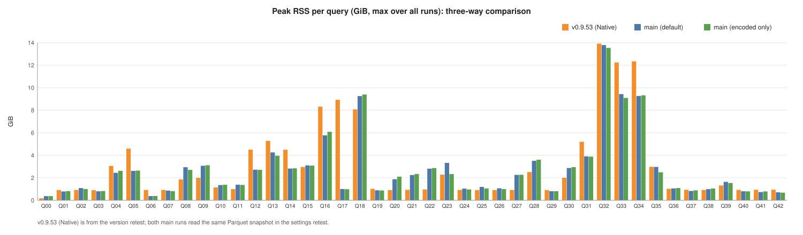
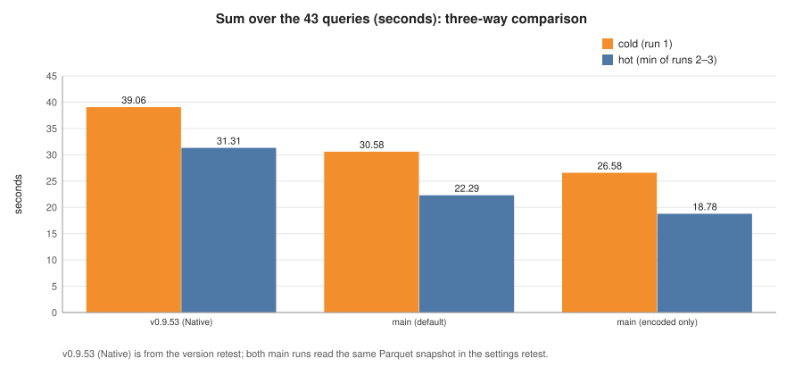
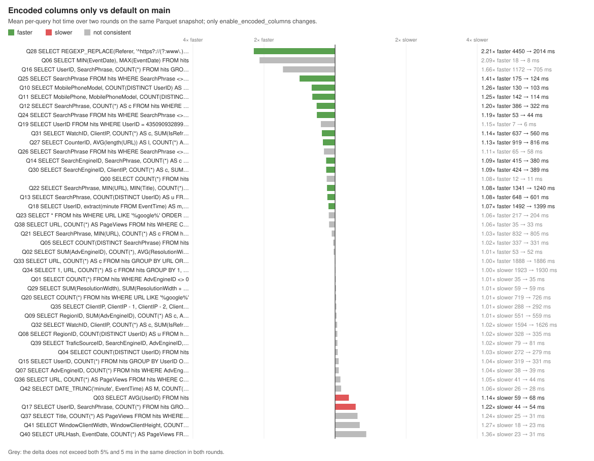

# ClickBench on main: encoded columns only

This follow-up compares `enable_encoded_columns=0` (default) and `1` on the same `7510716171` build and the same 784-block Parquet snapshot (99,997,497 rows). No other setting changes between the two arms. The deserialized column cache, condition cache and query result cache are off in both. Without the deserialized column cache, [#21159](https://github.com/databendlabs/databend/pull/21159) lets eligible scans retain Parquet string dictionaries; this is not a test of building numeric frame-of-reference encodings.

## Results

| configuration | cold sum | hot sum | peak RSS |
|---|---:|---:|---:|
| Default | 30.58 s | 22.29 s | 13.79 GiB |
| Encoded columns only | 26.58 s (−13.1%) | 18.78 s (−15.8%) | 13.54 GiB |

- **13 queries consistently improved:** Q10, Q11, Q12, Q13, Q14, Q18, Q22, Q24, Q25, Q27, Q28, Q30 and Q31. **Two consistently regressed:** Q03 (`AVG(UserID)`, 59.1 → 67.6 ms) and Q17 (44.0 → 53.8 ms). A change must exceed both 5% and 5 ms in the same direction in both rounds.
- **Q28** (`REGEXP_REPLACE(Referer, ...)`) accounts for about 69% of the hot-time savings: 4.55 → 2.05 s and 4.35 → 1.98 s. This is consistent with [#20873](https://github.com/databendlabs/databend/pull/20873) evaluating `regexp_replace` and `length` on dictionary values, combined with #21159 retaining those dictionaries. The setting was isolated; the two PRs were not.
- **Sensitivity:** Excluding Q28, the hot sum drops 6.0%. Excluding Q16 as well, which varied from 0.72 s to 1.63 s in the default arm, the hot sum drops 3.7%.

## Charts

The three-way charts add `v0.9.53` from the [default-settings version retest](../README.md) as the old-version reference. It reads Native and was timed in a separate run. Both `main` series use the same Parquet snapshot and are the controlled comparison for encoding. All three series use the mean over the two rounds, with each round's hot time taken as the faster of runs 2 and 3. That gives `v0.9.53` a hot sum of 31.31 s instead of the 31.00 s reported in the version retest, which takes the best hot time across rounds.

| configuration | cold sum | hot sum | peak RSS |
|---|---:|---:|---:|
| `v0.9.53` (Native) | 39.06 s | 31.31 s | 13.92 GiB |
| `main` (default) | 30.58 s | 22.29 s | 13.79 GiB |
| `main` (encoded columns only) | 26.58 s | 18.78 s | 13.54 GiB |

**Against `v0.9.53`** (1× baseline); both `main` variants have a bar and all three hot times are shown at right:

**Peak RSS per query** (GiB):

**Sum over the 43 queries** (seconds), cold and hot:

### Same-snapshot charts (main only)

## Method and raw data

These are the two relevant arms selected from an interleaved settings run. Both use the original ClickBench SQL and one table load, with Query and Meta pinned to CPUs 0–15. Each query/configuration pair starts fresh Query and Meta processes after file-page eviction and runs the query three times. The cold time is run 1; hot is the faster of runs 2 and 3. Both times are averaged per query across the two rounds before summing. Peak RSS is the highest Query RSS sampled across all runs. The archive contains 172 cells and 516 successful timed queries.

All 43 queries returned the same row counts between arms. Order-independent result fingerprints differ on Q24, Q30, Q31, Q32, Q38, Q39, Q40 and Q41; every one of those cases also varies among repetitions with encoding off. The timed SQL was left unchanged.

[Manifest and effective settings](manifest.json) · [Round 0](results/round0.json) · [Round 1](results/round1.json) · [Default-settings version retest](../README.md)

Run `python3 charts.py` in this directory to regenerate the SVGs from the archived timings.
